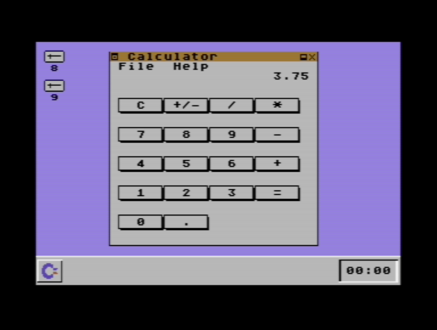

# Calculator64

A decimal calculator app for [GUI64](https://github.com/WebFritzi/GUI64) on the
Commodore 64 — to my knowledge, the first calculator written for the GUI64
desktop environment.

## Features

- 9 significant decimal digits with true decimal arithmetic
  (no binary-float surprises: `0.1 + 0.2 = 0.3`)
- `+` `-` `x` `/` with chained calculations, `+/-` sign toggle, `C` clear
- Decimal point entry, plain and scientific display (`9.99999998E17`), half-up rounding
- Errors on division by zero and on out-of-range results
- Mouse and keyboard input
- Fits the WIN and MAC designs of GUI64 2.1

## Requirements

- GUI64 v2.1 (cartridge or disk image)
- A mouse in port 1 (or just use the keyboard)
- For emulation: VICE (`x64sc`) with the GUI64 cartridge attached

## Install

1. Copy `calculator.d64` (or just `calculator.gui`) to your SD card / USB stick.
2. Inside GUI64, open the disk and run `calculator.gui`.
3. The calculator window opens; it can be moved, minimized and closed like any
   GUI64 window.

## Controls

| Key | Action |
| --- | ------ |
| `0`-`9`, `.` | Digits and decimal point |
| `+` `-` `*` `/` | Operators |
| `=` or RETURN | Equals |
| `C` or `c` | Clear |
| `+/-` button | Toggle sign |

Everything can also be entered with the mouse.

## Building

Requires [ACME](https://sourceforge.net/projects/acme-crossass/) and `c1541`
(from VICE):

    ./build.sh

This produces `calculator.gui` (the app) and `calculator.d64` (disk image).

## Tests

- `test_gui64.py` — drives the built app inside a real GUI64 cartridge via
  VICE's remote monitor and checks 22 interactive cases (mouse, keyboard and
  regression tests for the runtime quirks below). Set `GUI64_CART` to your
  GUI64 v2.1 cart if it is not at the default path.
- `test_math.sh` + `verify_math.py` — assemble the standalone decimal math
  harness, run it in VICE and check all 20 arithmetic results.

## GUI64 v2.1 quirks worked around

These are GUI64 runtime issues the app compensates for:

- The runtime's mouse scan only covers the first 16 controls, so the last
  four buttons (`3`, `=`, `0`, `.`) are hit-tested by the app.
- The runtime can leave a button drawn as pressed after mouse-up; the app
  clears pressed flags on `EC_LBTNRELEASE`.
- `GUI_SelectControl` loses a carry for control indices >= 16, so the app
  sets/clears these buttons' flags directly in the control heap.
- The runtime delivers events through a single `exit_code` byte that the
  IRQ overwrites, so a pending mouse-release can be lost while the app
  repaints. All pressed buttons are then drawn from the same shared
  charset chars (240-255), so the next pressed button makes the stuck one
  flash its label. The app detects this on later events (no mouse button
  held, yet a button is still marked pressed) and unsticks it.

## Credits

- [GUI64](https://github.com/WebFritzi/GUI64) by WebFritzi — the desktop the
  app runs on.
- Calculator64 written by Guillermo Power.
- Developed with AI assistance (code, tests and documentation).

## License

The calculator's own code (`Calculator.asm`, `calc_math.asm`, `build.sh`,
tests) is released under the MIT License — see [LICENSE](LICENSE).

`gui64.inc.asm` is part of the GUI64 project, (c) WebFritzi, licensed under
[CC BY-NC 4.0](https://creativecommons.org/licenses/by-nc/4.0/); it is
included here for convenience, so this repository as a whole is intended for
non-commercial use.
